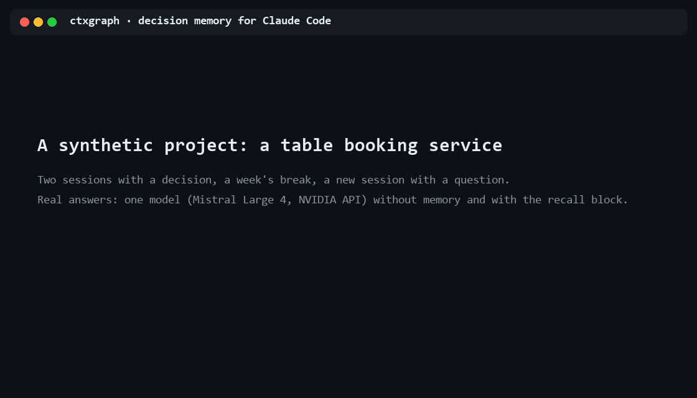
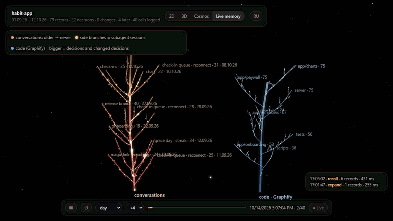

<p align="center"></p>

# cotrail — decision memory for AI coding assistants

**English** · [Русский](README.ru.md)

> **Tell your agent:** `install cotrail: github.com/egor-ml-research/cotrail`
>
> It follows [INSTALL_FOR_AI.md](INSTALL_FOR_AI.md): installs the package, registers the memory in the client it runs
> in, shows your earlier chats of this project and imports them only after your "yes".
>
> **Works with:** Claude Code (installation by this phrase checked).
>
> **Configs written per official docs, not yet verified:** Cursor, Codex CLI, Gemini CLI, Claude Desktop, Windsurf,
> Cline, OpenCode (`cotrail setup --client <name>`; sources in [docs/clients.md](docs/clients.md)). For Claude
> Desktop the one-click extension `.mcpb` from the release is the simplest way.

Your assistant forgets what you decided last week. cotrail remembers it.

cotrail is a local memory of your conversations with Claude Code, organised around **decisions**: what you decided
to do, what you decided not to do, what you put on hold, and when the assistant reported it done. It runs as an MCP
server next to Claude Code. Before answering, the assistant can ask it what was decided earlier in the project. The
answer comes with dates and statuses, and every turn is recorded automatically.



*A synthetic project. The memory block is the real output of `recall`; the answers are real answers of one model
(Mistral Large 4) without memory and with that block.*

- **Local only.** One SQLite file per project on your machine. No cloud, no account, no LLM calls to build the memory.
- **Works on the history you already have.** On first connection it imports your earlier Claude Code sessions of the
  project (if you agree) and shows the decision chronology right away.
- **One command to connect.** `cotrail setup` writes the MCP config and the hook for the project you are in.
- **Small answers.** When nothing in memory is about the question, recall answers in one line instead of a block.
  One-line records show the sentence that answers the question, and in one session a record is not repeated.
- **A project map in one call.** `overview` gives a new chat the areas of the code (from the Graphify graph:
  main files, functions, links) with the newest decisions about each, in about 600 tokens, without reading code.
- **A graph you can look at.** `cotrail view` opens a local 2D or 3D map of topics, concepts and decisions. A
  [Graphify](https://github.com/Graphify-Labs/graphify) code graph can be shown on the same map.

**Renamed in v0.7.0:** cotrail was called ctxgraph (PyPI package `think-to-recall`, repository egor-ml-research/think-to-recall; old links redirect). An existing install keeps its memory: `~/.ctxgraph` is read in place (`cotrail migrate-home` copies it to `~/.cotrail` if you like), `CTXGRAPH_*` variables are still read, and the old commands `ctxgraph`, `ctxgraph-mcp`, `ctxgraph-mcpw` keep working until 2027-02 with a one-line hint. To switch: `uv tool uninstall think-to-recall`, then `uv tool install cotrail` and `cotrail setup` in the project (it replaces the old entries and hooks).

## Install

One line (Python 3.11+ and [uv](https://docs.astral.sh/uv/)), from the project you want to connect:

```bash
uv tool install cotrail && cotrail setup
```

With [pipx](https://pipx.pypa.io/) instead of uv:

```bash
pipx install cotrail && cotrail setup
```

**Works right away, without downloading a model.** Recall is BM25 over your conversations; the install is about
125 MB. The quality mode is optional: it adds multilingual-e5-base (int8 ONNX, about 300 MB, no PyTorch) and fuses it
with BM25, which finds a few more answers worded differently from your question:

```bash
uv tool install --reinstall "cotrail[quality]" && cotrail setup --quality
```

For finer English concepts in the
graph view, add the `english` extra and run `python -m spacy download en_core_web_sm`. **Installing through an AI assistant?** Point it to
[INSTALL_FOR_AI.md](INSTALL_FOR_AI.md).

**Claude Code plugin.** The same memory as a plugin (MCP server, a skill on when to call the tools, and the hooks):
`/plugin marketplace add egor-ml-research/cotrail`, then `/plugin install cotrail@cotrail`. See
[plugins/cotrail](plugins/cotrail/README.md).

`setup` asks all its questions once, before doing anything, and Enter takes the default:

| question | default | flag |
|---|---|---|
| import this project's earlier Claude Code sessions | yes | `--import-history yes\|no` |
| build a code graph with Graphify (only when code is found; installs `graphifyy`, ~150 MB, local AST, no LLM) | no | `--graphify yes\|no` |
| download WordNet data that names the topics in `expand` (~10 MB) | yes | `--wordnet yes\|no` |

`-y` takes the defaults. **Without a terminal** (an assistant running setup for you) nothing is imported, installed
or downloaded unless a flag says so: only the server and the hook are written, and the end lists what was skipped,
with the command for each.

Then it does four things:

1. Registers the `cotrail` MCP server **without any path that could end up in git**. With the `claude` CLI on
   PATH it runs `claude mcp add --scope local cotrail -- cotrail-mcp`: the entry is kept in your own Claude Code
   config for this project, not in the repository. Without the CLI it adds to the project's `.mcp.json` only
   `{"command": "cotrail-mcp"}` (no home folder, no Python path, no project path); other servers in that file are
   kept. The server takes the project from the folder Claude Code starts it in.
   On Windows it registers `cotrail-mcpw` instead: the same server behind a GUI launcher, so Claude Desktop and
   the Claude Code desktop app open no console window for it.
2. Adds a Claude Code **Stop hook** `cotrail hook-stop` to `.claude/settings.local.json`. After every turn it queues
   the session transcript; the project comes from the hook's input. The hook is fast: it only appends a path, and the
   server reads the transcript later. Other hooks and settings are kept, and an earlier cotrail hook is replaced.
   A **SessionStart hook** `cotrail hook-start` puts one line into each new session when something is open "for
   later" (see `later` below); nothing when nothing is open.
3. **Downloads nothing by default.** Recall works on BM25 over the stored sentences (Russian words lemmatized with
   pymorphy3, whose dictionaries ship with the package). With `--quality` setup **asks before downloading** the
   sentence encoder multilingual-e5-base as int8 ONNX
   ([Xenova/multilingual-e5-base](https://huggingface.co/Xenova/multilingual-e5-base), an export of
   [intfloat/multilingual-e5-base](https://huggingface.co/intfloat/multilingual-e5-base), MIT; about 300 MB, a pinned
   revision) and turns the quality mode on: BM25 and the encoder's vectors are fused by reciprocal rank fusion. The
   download happens once; after that every cotrail process runs with the Hugging Face hub offline. A memory built
   in the default mode is moved aside and rebuilt (pinned rules are kept). If the download fails (no network, proxy),
   setup says what was not downloaded, from where, and to rerun it; a partial download resumes.
4. Imports the project's earlier Claude Code sessions (`~/.claude/projects/<project>/*.jsonl`) if you agreed, and
   prints the **decision chronology**, so you see what the memory knows straight away.

Restart Claude Code in the project folder and approve the `cotrail` server when it asks.

### Installing through an AI assistant

Point the assistant to [INSTALL_FOR_AI.md](INSTALL_FOR_AI.md). Before running `cotrail setup` it asks you, in one
message, with the default in brackets:

1. "Import the history of your earlier conversations about this project, so the memory knows right away what you
   decided? (no)" -> `--import-history yes|no`
2. "Will you work with code in this project? (no)" - if yes: "Also install Graphify, so the memory sees the
   structure of the code (what calls what)? (no)" -> `--graphify yes|no`; if no, `--graphify no` without the second
   question.
3. "Which language for the memory's labels - Russian or English?" -> `--lang ru|en` (not asked when the language is
   obvious from the conversation).

No answer means the safe values: no / no / the language of the conversation.

### Recommended `.gitignore`

The memory itself lives outside the project (`~/.cotrail/<project>/`), and `setup` writes no paths into shared
files. Still, keep the per-user and generated files out of the repository:

```gitignore
# cotrail: per-user Claude Code settings (the Stop hook) and local data
.claude/settings.local.json
.cotrail/
```

`.cotrail/` matters if you point `--home` / `COTRAIL_HOME` inside the project. `cotrail view` writes its HTML
into the memory folder; if you pass `--out` inside the project, ignore that file too: it embeds quotes from your
conversations. If your team does not use cotrail, keep the `cotrail` entry out of a shared `.mcp.json`
(with the `claude` CLI, setup does not write it there at all).

Options: `--quality` turns on the quality mode (see above), `--yes` agrees to the questions (for scripts),
`--no-model` only writes the config files, `--no-import` skips the history, `--home DIR` keeps the stores somewhere other than `~/.cotrail`, and `--print-cursor` prints a
Cursor config. `--client <name>` registers the memory in another client (see the first block); for Cursor, Codex CLI
and Gemini CLI it also writes their hooks for auto-recording (per their docs, not yet verified).

## Use

In Claude Code the assistant gets these tools:

| tool | what it does |
|---|---|
| `recall(question, steps, detail)` | finds earlier turns relevant to the question and to the assistant's reasoning steps; `detail="brief"` gives one line per record (date, status, topic, gist, `#id`), `"mixed"` the best records in full and the rest as lines; one line when nothing is about the question; `fresh=True` repeats records already shown in the session |
| `overview()` | a map of the project in ≤ ~600 tokens without reading code: areas of the Graphify code graph (main files, functions, links between areas), ranked by entry points, PageRank and recent commits, with the newest decisions that name their code or whose commit touched it (tests / scripts / docs, git-ignored paths and the patterns in an `overview.exclude` file are left out); without a code graph, conversation topics with their newest decisions. Call it first in a new chat |
| `expand(id)` | one record in full (exact wording, numbers, commits) and the thread of its topic by date: how it started, what changed, the reports |
| `decisions(limit)` | the decision chronology, newest first, with confirmations and reports |
| `later(limit)` | what was put off: decisions on hold ("later", "на потом", TODO), proposals you answered "later", and deferred [Beads](https://github.com/gastownhall/beads) issues from `.beads/*.jsonl` (read only). An item closes itself when a later report of done work matches it; recall adds a line of open items on the same topic |
| `rules`, `pin_rule`, `unpin_rule` | the project's pinned permanent rules (only "always / never / from now on" rules you stated; not ordinary or conditional decisions); `pin_rule(text, scope="global")` pins one for all projects |
| `save_chat(title, turns)` | save the current chat of Claude Desktop / Cursor ("add this chat to memory"); repeat-safe |
| `import_claude_ai(export, match)` | import chosen chats from a claude.ai data export |
| `remember(text)` | save one statement explicitly |
| `import_history` | import earlier sessions (only when you ask), then show the chronology |
| `forget(episode)` | hide one turn from recall |
| `memory_status`, `show_graph` | what is stored; the path of the graph view |

The same things are available from the terminal:

```bash
cotrail decisions --limit 30
```

```bash
cotrail recall "which encoder do we use" --step "an earlier decision about the model" --step "a size limit the user set"
```

```bash
cotrail expand 1a2b3c4d   # a record id shown by recall
```

```bash
cotrail rules --add "Never push to main without asking"
```

```bash
cotrail pin-rule --global "Answer in English"   # a rule for all projects: in every project's rules, recall and session line, marked (global)
cotrail rules --global                          # list them; `cotrail rules --remove <id>` removes one from any folder
```

```bash
cotrail projects   # every project with a memory: path, number of records, date of the last record
```

A read command (`rules`, `recall`, `decisions`, `later`, `expand`, `overview`, `status`, `view`) run in a folder
without a memory does not answer "not found": it lists the known projects (or uses the only one) and suggests
`--project <path>`.

```bash
cotrail import
```

```bash
cotrail view --3d
```

### JSON output

`cotrail recall "..." --json`, `decisions --json`, `later --json`, `rules [--global] --json` and `projects --json`
print a JSON array (UTF-8, no labels or colors) for scripts and bulk work, e.g. "all decisions of the month on topic X,
grouped" in one script instead of many MCP calls. Every object has `id`, `date` (YYYY-MM-DD), `status`, `topic`
(the topic name, `""` when none) and `text`; the other keys depend on the command:

| Command | `status` | Other keys |
|---|---|---|
| `recall` | the sentence status: `decision`, `rule`, `report`, `applied`, `proposal`, `said`, `pasted`, ... | `kind` (decision kind: `yes`, `no`, `hold`, ...), `gist`, `role`, `ts`, `line` (`main` / `follow` / `periphery`), `score`, `source`, `session`, `report` (`{id, date, text}` or `null`) |
| `decisions` | `decision`, or `confirm` for a short confirmation of a proposal | `kind`, `ts`, `commit`, `done` (`{date, commit, text}` or `null`), `resolved` (`{date, commit, confirmed, text}` or `null`) |
| `later` | `later` | `kind` (`hold`), `source` (`chat` / `beads`), `ts` |
| `rules` | `rule` | `origin` (`auto` / `manual` / `global`) |
| `projects` | `project` | `path`, `records`, `store`, `exact_path`; `id` is the store folder, `date` the last record, `text` the path |

New keys may be added; these ones keep their meaning.

## Claude Desktop, Cursor and claude.ai chats

**Save the current chat.** In any MCP client (the Claude Desktop Chat tab, Cursor) say *"add this chat to memory"*.
The assistant calls `save_chat` with the chat's turns word for word (in portions of up to 30 turns for long chats).
It is safe to repeat: saying it again later in the same chat adds only the new turns, the memory is never rebuilt.
Saved chats get the same statuses as Claude Code sessions (decisions, rules, reports) and the source "chat".
After that the assistant keeps saving on its own: when a conversation produces a decision, a refusal, a rule or a
"later" item, it calls `save_chat` with the new turns at the end of its answer. If nothing was saved for 12 hours,
one `recall` answer carries a one-line reminder (not in Claude Code, which records every turn by its hook).

**Claude Desktop extension (no developer mode).** Install the package once in a terminal
(`uv tool install cotrail==0.7.2`, or the same with `pipx install`), then download `cotrail-0.7.2.mcpb`
from the [release page](https://github.com/egor-ml-research/cotrail/releases/tag/v0.7.2) and open it (or drag it
into Claude Desktop → Settings → Extensions). Claude Desktop asks for the project folder; the memory of that folder
is used. The extension contains no code: it runs the `cotrail-mcp` you installed (`~/.local/bin`; on Windows `cotrail-mcpw.exe`).
cotrail is not offered as a remote "custom connector" URL on purpose: a connector runs on a server, and this memory
stays on your computer.

**claude.ai chats.** Export your data (claude.ai → Settings → Privacy → Export data), then ask the assistant to
import it (`import_claude_ai`: without a filter it lists the conversations and asks which belong to the project),
or run `cotrail import-claude-ai export.zip --match "..."`. Re-importing a newer export adds only new messages.
The export is a one-time import of your history; after it, new chats are saved through the assistant
(`save_chat`), no new exports needed.

## One memory server for several projects

A client that runs one server for all chats (Claude Desktop) can use every project's memory: each memory tool takes
`memory=<name>` (the repository or folder name, as `list_memories` shows it). When the server's folder holds several
projects (a projects root or your home folder), there is no default: a call without `memory=` returns the list, and
an ambiguous name returns the choices. In Claude Code the session folder is the memory, nothing to choose.

The assistant can also connect things for you, always as a dry run first: `connect_folder` (a folder to its own or an
existing memory, with its Claude Code chats), `find_chats` / `import_chats` (earlier Claude Code chats or a claude.ai
export, imported only after `confirm=true`).

**Inbox.** Tasks for Claude Code that an advisor chat (claude.ai / Claude Desktop) wrote under «Сообщение для Claude
Code:» / "Message for Claude Code:" become inbox items: the session start shows the open ones, `inbox` lists them,
and an item closes only on an explicit report (its id and a done word) or by hand (`cotrail inbox done <id>`;
`reopen <id>` opens it again). The same rule closes "later" items; a near match only says "looks done - confirm".

## Team memory (experimental)

Several people on one project can share one memory through a **private** git repository (GitHub, GitLab, any git
host). Experimental in 0.7.2: try it on one project first.

**Setup in one phrase.** Create an empty private repository, then tell the assistant in the project:
`join the team memory: <url of the private repo>`. It calls `join_team`, which shows a dry run first: the
repository's visibility (a public repository is refused), the name on your records, how many records would be pushed
and which are held back by the secret check. Only after your "yes" does it join. By hand: `cotrail team join <url>`
(`--dry-run` to only look). Everyone else runs the same command with the same url.

**What syncs:** your conversation turns of that project (prompts and visible replies, after the secret filter, home
folders shortened to `~`), who wrote each record, chat titles, and, if you agree (`--graphify yes`), the Graphify code
graph (names and relative paths, no source code). Each device writes only its own log file, so there are no merge
conflicts. **What does not:** the SQLite store (each device rebuilds it from the logs), your code, other projects,
anything a record never contained. A record forgotten with `forget` stops syncing from you but is not removed from the
others.

**Check:** `cotrail team status` (members, records per member, last sync, what is not synced yet);
`cotrail team check` scans your copy of the memory repository for keys, e-mails and home folders. `cotrail team leave`
turns sync off for the project; the local memory stays.

**What was tested how.** Between two real Windows machines with a GitHub repository: `team join`, authors,
`team status`, the Claude Code hooks (Stop / SessionStart) and the Graphify git hooks, and the background push reaching
GitHub. **Only in a simulation** (WSL, a local bare repository, no GitHub): the sync driven by the MCP server itself (for
clients without hooks), the Cursor / Codex / Gemini CLI hooks, the code graph syncing both ways, and recall finding
the other member's decision with its author. No client other than Claude Code has been checked live.

## How recall works

**One unit = your turn plus the assistant's report.** A turn of yours and the assistant's last message before your
next turn form one unit. That last message is the report of what was done. It is shown nested under your request and
does not take a result slot of its own. The assistant's intermediate messages ("running the tests now…") are
progress and are not searched.

**Main line + periphery.** `recall` first searches by the question itself (BM25 by default, BM25 + e5 in the quality
mode; a turn is scored by its best sentence). That is the **main line**: it comes first and is never displaced. The assistant also passes
1–3 short **reasoning steps**, such as "an earlier decision about this component" or "a constraint the user stated".
Turns found only through those steps form the **periphery**. They are added after the main line, without duplicates,
only in the space left in the block. The periphery is how a memory that looks unrelated to the question still turns
up: a constraint you mentioned once, three weeks ago, in another context.

**The same entity.** A decision changed later in other words ("we switch from Postgres to SQLite") may share no word
with the question ("which database did we choose?"). So from the turns found by the question recall takes their rare
entities (concepts that occur in a few turns, not everywhere) and adds up to 3 later turns that mention them to the
chronology, marked "same entity: Postgres". They never push out what the question found.

**Topics.** Every record belongs to a topic: a community of the concept graph (Leiden), named by its most connected
concepts. `expand(id)` shows the record in full and the other records of its topic and of its entities, by date.

**Statuses and chronology.** Every remembered sentence has a status, found by rules (no LLM):

- your sentences with decision cues are decisions: *do*, *not do*, or *on hold*;
- the assistant's sentences are *done* when they report finished work (a commit, "fixed", "published"), and
  *proposal, not applied* when they offer or draft something.

Results are shown oldest first, each with its date and status, so a later decision that changed an earlier one comes
after it. `decisions` lists the chronology newest first. A
decision is followed by the report that carried it out (date, commit), when one is found. A decision on hold is
followed by its later confirmation and execution.

**Fewer tokens.** If no remembered record holds enough of the question's words (in the quality mode: or is close to it by
meaning), recall answers with one line, "Nothing in memory on this question", instead of a block. In one-line records
(`detail="brief"`, and the short records of `"mixed"`) the gist is the decision or report sentence that shares the most
words with the question. Labels are compact: `11-18` for a date of this year, a short `#id` that `expand` accepts,
the topic once per run of lines. With `detail="brief"`, a record already shown in the same session comes back as one
short line, "`#id` (shown earlier): date · gist". After a context compaction or in a new session every record is
shown in full again; `recall(..., fresh=True)` does the same at once. Set `COTRAIL_ECONOMY=off` for the previous
behaviour.

**Pinned rules.** Standing rules you state ("always…", "never…", "by default…", "keys only in `.env`") are pinned and
shown at the top of every recall result, whatever the question. You can also pin or unpin rules by hand. The same rule is pinned once (case, punctuation and a
pasted `#id date (origin):` prefix do not count), and cotrail's own output pasted into a chat (`rules`, recall,
`decisions`, `later`) never becomes a new rule, decision or "later" item.

**Short confirmations.** A short reply of yours (up to three words, not a question) has no content of its own, for
example "yes", "go ahead", "not now" or "done". It is read as an answer to the assistant's previous message. "Yes" /
"go ahead" confirm the assistant's proposal, "no" rejects it, "later" defers it, and "done" closes a request the
assistant made to you. The result is shown on that message ("proposal → confirmed by the user on 2026-11-18"). The
short reply gets no search slot of its own, and the report that follows it belongs to it.

## Graph view

`cotrail view` writes one self-contained HTML file into the project's memory folder and opens it. The page needs
no network: the graph libraries are vendored.

- **Topics** are communities of concepts. A concept shared by several topics is drawn in their colors.
- **Per topic**, the page shows what `recall` returns for it (the same block the assistant gets) and the decisions
  about it.
- **The decisions journal** lists all decisions by date: do / not do / on hold.
- **2D / 3D**: switch in the sidebar, or open in 3D with `cotrail view --3d`. 2D uses
  [force-graph](https://github.com/vasturiano/force-graph) and 3D uses
  [3d-force-graph](https://github.com/vasturiano/3d-force-graph) (both MIT).
- **Cosmos**: `cotrail view --cosmos` (or the «Космос» switch) draws the project as a galaxy on plain Canvas 2D:
  the core is the project, topics are constellations scattered in 3D, concepts are stars; the Graphify code is shown as
  constellations of its own. It has a greeting card with what changed
  since your last visit and a dashboard («Панель») with activity, topics, most connected concepts, recent decisions
  and search. Without a flag, the page opens in the mode you used last.
- **Live memory** (`cotrail view --live` serves it on 127.0.0.1 and streams new calls): the project as two trees in
  3D ([three.js](https://github.com/mrdoob/three.js), MIT). Conversations: the trunk is the project's time, each chat
  is a branch, sessions started by another session (subagents) are side branches, every message is a glowing bead;
  decisions are bigger. Code (if a Graphify graph is imported): a branch per folder, a twig per file, a bead per symbol.
  Each `recall` the assistant makes sends a pulse up the trunk to the messages it returned; `expand` lights the record
  and its chain of decision changes. The MCP server logs its calls to `calls.jsonl` next to the store (tool, record ids,
  duration; no query or record text; at most ~2 MB); the page can also replay a period of that log.
- **Language**: English by default, Russian with the EN / RU switch (or `?lang=ru` in the page URL).



The demo is synthetic (a fictional habit tracker): `python scripts/demo_views.py OUT --lang en` builds it from
`demo/habit_app.en.json`.

### Code from Graphify

[Graphify](https://github.com/Graphify-Labs/graphify) (Apache-2.0) builds a graph of a codebase from its syntax tree
and writes `graphify-out/graph.json`. To show your code next to your conversations:

```bash
cotrail import-graphify path/to/repo/graphify-out
```

Every edge then has an **origin label**:

- `conversation`: between concepts of your conversations (round nodes, topic colours);
- `code`: extracted from the code by Graphify (square nodes, slate colour);
- `inferred`: guessed rather than extracted. Graphify's own INFERRED / AMBIGUOUS edges are drawn as a grey dashed
  line. Links between a conversation concept and a code node are drawn as a yellow dashed line. cotrail makes such a
  link only when a file path or identifier said in the chat exactly matches a file or symbol in the graph. It does not
  match by similarity, and it skips generic names such as `main` or `utils`.

Layers can be switched on and off in the sidebar. Clicking a code node shows its file and line, its code relations,
and the conversation concepts and decisions that mention it. Re-importing replaces the code layer.

## Privacy

- Everything stays on your machine. Each project has its own store: `~/.cotrail/<project>/graph.sqlite`.
- Only what people said is imported: your prompts and the assistant's visible prose. Tool calls and their output,
  thinking, system reminders, subagent sidechains, code blocks, command lines and log output are dropped.
- **Secrets and personal data are scrubbed before storage**, by pattern: API keys and tokens, private keys,
  passwords and secrets in assignments, credentials inside URLs, e-mail addresses and phone numbers. A match is
  replaced with `[REDACTED:<kind>]` before the text reaches the database. Pattern matching can miss secrets of
  unusual formats.
- After the one-time model download, nothing goes to the network.
- The graph view embeds quotes from your conversations. Treat the HTML file as private, like the store itself.
- `forget` hides a turn from recall. To remove a project's memory completely, delete its folder in `~/.cotrail`.

## Compared with Hindsight

[Hindsight](https://github.com/vectorize-io/hindsight) (MIT) is an agent memory that has an LLM extract facts,
entities and dates from every chunk, then consolidate them into observations. Its recall combines vectors, BM25, an
entity/time graph and a reranker. This comparison is by its documentation and paper; we have not run it on our history.

- **Building.** Hindsight calls an LLM for every chunk it stores. cotrail calls none and keeps your turns as they were.
  For our project's history (about 1.5M characters) we estimate 20–40 hours to build Hindsight on a laptop CPU with a
  local 3B model through Ollama. This is an estimate, not a measurement. cotrail builds the same history in seconds.
- **What comes back.** cotrail returns your turns verbatim, without an LLM paraphrase, with dates and statuses. It
  marks a decision replaced later as outdated. Hindsight returns the facts its LLM extracted, and reflect answers with an LLM.
- **Where Hindsight is ahead.** It has entity resolution, time-window queries, a reranker and published scores on
  LongMemEval and LoCoMo (with 20B–120B models). cotrail took one idea from it, merging name variants of a concept
  ("Postgres" / "PostgreSQL") by trigram similarity, re-implemented without an LLM.


## Limits

- **Rules, not an LLM.** Statuses, decisions, reports and confirmations are found by cue words and structure, tuned
  on Russian and English conversations. They miss some decisions and mislabel others. The decisions list says so. English cues are checked on a
  synthetic held-out set of developer turns (`tests/realworld_en`, `scripts/eval_en_cues.py`): 64 of 81 sentence
  labels and 25 of 29 short answers right in v0.6.11 (40 and 15 before).
- **Recall searches conversations, not code.** The Graphify layer is shown in the graph view only.
- **Name links are exact.** A code symbol is linked only when the chat names it exactly as written. Only concepts
  frequent enough to appear in the view get links drawn.
- **Size and speed.** The default install is about 125 MB and needs no model; importing a long history takes about
  a minute. The quality mode adds about 300 MB and makes the first import several times slower (291 s against 69 s
  for 775 turns on a laptop CPU). A store remembers its mode; switching to `--quality` rebuilds it.
- **Lexical by default.** BM25 finds what shares words with your question. On our check of 29 questions about past
  decisions it was correct on 19 (e5 alone: 18, BM25 + e5: 21; measured on 784 turns, later turns move these by about one
  question) and never showed an outdated answer as current, but
  it misses answers worded differently from the question (for example, "DB" for "database"); `--quality` recovers
  some of them.
- **Two languages.** Status labels follow the project's language (the language of most of your messages);
  `cotrail --lang en|ru …` or `COTRAIL_LANG` sets it. Cue words exist for English and Russian only.
- **Claude Code first.** Automatic recording is verified with the Claude Code Stop hook; the Cursor, Codex CLI and
  Gemini CLI hooks follow their docs and are not verified yet. Other clients' chats are saved when you ask (`save_chat`). Chats from claude.ai can be imported from a data export with `cotrail import-claude-ai`.
- **Tested on Windows and on a clean Linux install.** macOS has not been checked yet.

## Research

cotrail grew out of a research project on retrieval for conversational memory. Experiments, pre-registrations and
results: [docs/research_README.md](docs/research_README.md) (in this repository).

## License

Apache-2.0. Vendored libraries keep their own licenses (`cotrail/vendor/*.LICENSE`).
