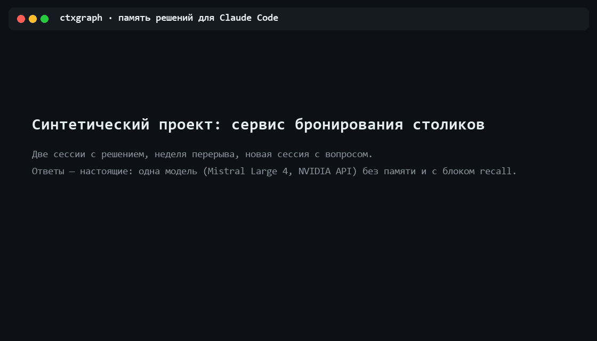

<p align="center"></p>

# ctxgraph — память решений для ИИ-ассистентов программиста

[English](README.md) · **Русский**

Ассистент забывает, что вы решили на прошлой неделе. ctxgraph помнит.

ctxgraph — локальная память ваших разговоров с Claude Code, устроенная вокруг **решений**: что решили делать, что
решили не делать, что отложили и когда ассистент отчитался о выполнении. Она работает как MCP-сервер рядом с Claude
Code. Перед ответом ассистент может спросить у неё, что было решено раньше в проекте. Ответ приходит с датами и
статусами, а каждая реплика записывается автоматически.



*Синтетический проект. Блок памяти — настоящий вывод `recall`; ответы — настоящие ответы одной модели (Mistral Large 4)
без памяти и с этим блоком.*

- **Только локально.** Один файл SQLite на проект на вашем компьютере. Без облака, без аккаунта, без вызовов LLM при
  построении памяти.
- **Работает на уже накопленной истории.** При первом подключении импортирует прежние сессии Claude Code этого проекта
  (если вы согласны) и сразу показывает хронологию решений.
- **Одна команда для подключения.** `ctxgraph setup` записывает настройки MCP и хук для проекта, в котором вы находитесь.
- **Короткие ответы.** Если в памяти нет ничего по вопросу, recall отвечает одной строкой, а не блоком. В записях
  одной строкой видно предложение, которое отвечает на вопрос, а в одной сессии запись не повторяется.
- **Карта проекта одним вызовом.** `overview` даёт новому чату части кода (из графа Graphify: главные файлы,
  функции, связи) с последними решениями по каждой — примерно в 600 токенах, без чтения кода.
- **Граф, который можно посмотреть.** `ctxgraph view` открывает локальную 2D- или 3D-карту тем, понятий и решений. На
  той же карте можно показать граф кода [Graphify](https://github.com/Graphify-Labs/graphify).

## Установка

Одна строка (Python 3.11+ и [uv](https://docs.astral.sh/uv/)), из папки проекта, который хотите подключить:

```bash
uv tool install "think-to-recall @ git+https://github.com/egor-ml-research/think-to-recall@v0.5.8" && ctxgraph setup
```

С [pipx](https://pipx.pypa.io/) вместо uv:

```bash
pipx install "think-to-recall @ git+https://github.com/egor-ml-research/think-to-recall@v0.5.8" && ctxgraph setup
```

**Работает сразу, без загрузки модели.** Поиск — BM25 по вашим разговорам; установка около 125 МБ. Режим качества —
по желанию: он добавляет multilingual-e5-base (int8 ONNX, около 300 МБ, без PyTorch) и сливает её с BM25, что находит
ещё несколько ответов, сформулированных иначе, чем вопрос:

```bash
uv tool install --reinstall "think-to-recall[quality] @ git+https://github.com/egor-ml-research/think-to-recall@v0.5.8" && ctxgraph setup --quality
```

Пакета пока нет в PyPI; команды ставят релиз v0.5.8 с GitHub. Для более точных английских понятий на карте графа
добавьте набор `english`. **Ставите через ИИ-ассистента?** Дайте ему [INSTALL_FOR_AI.md](INSTALL_FOR_AI.md).

`setup` задаёт все вопросы один раз, до начала работы; Enter выбирает ответ по умолчанию:

| вопрос | по умолчанию | флаг |
|---|---|---|
| импортировать прежние сессии Claude Code проекта | да | `--import-history yes\|no` |
| построить граф кода через Graphify (только если найден код; ставит `graphifyy`, ~150 МБ, локальный AST, без LLM) | нет | `--graphify yes\|no` |
| скачать данные WordNet для названий тем в `expand` (~10 МБ) | да | `--wordnet yes\|no` |

`-y` берёт ответы по умолчанию. **Без терминала** (setup запускает ассистент) ничего не импортируется, не ставится и
не скачивается, если флаг не сказал иного: пишутся только сервер и хук, а в конце — список пропущенного с командой
для каждого пункта.

Затем он делает четыре вещи:

1. Регистрирует MCP-сервер `ctxgraph` **без путей, которые могли бы попасть в git**. Если на PATH есть `claude`, он
   выполняет `claude mcp add --scope local ctxgraph -- ctxgraph-mcp`: запись хранится в ваших собственных настройках
   Claude Code для этого проекта, а не в репозитории. Без `claude` он добавляет в `.mcp.json` проекта только
   `{"command": "ctxgraph-mcp"}` (без домашней папки, пути к Python и пути проекта); другие серверы в этом файле
   сохраняются. Проект сервер берёт из папки, в которой его запускает Claude Code.
2. Добавляет **хук Stop** Claude Code `ctxgraph hook-stop` в `.claude/settings.local.json`. После каждого хода он ставит
   транскрипт сессии в очередь; проект берётся из данных хука. Хук быстрый: он только дописывает путь, а сервер читает
   транскрипт позже. Другие хуки и настройки сохраняются, прежний хук ctxgraph заменяется.
   **Хук SessionStart** `ctxgraph hook-start` добавляет в каждую новую сессию одну строку, если есть открытые
   пункты «на потом» (см. `later` ниже); если их нет — ничего.
3. **По умолчанию ничего не скачивает.** Поиск работает на BM25 по сохранённым предложениям (русские слова приводятся
   к начальной форме через pymorphy3, его словари идут вместе с пакетом). С `--quality` setup **спрашивает перед
   загрузкой** модели multilingual-e5-base в int8 ONNX
   ([Xenova/multilingual-e5-base](https://huggingface.co/Xenova/multilingual-e5-base) — экспорт
   [intfloat/multilingual-e5-base](https://huggingface.co/intfloat/multilingual-e5-base), MIT; около 300 МБ,
   закреплённая ревизия) и включает режим качества: BM25 и векторы модели сливаются через reciprocal rank fusion.
   Загрузка происходит один раз; после неё все процессы ctxgraph работают с отключённым Hugging Face Hub. Память,
   собранная в режиме по умолчанию, откладывается в сторону и пересобирается (закреплённые правила сохраняются). Если
   загрузка не удалась (нет сети, прокси), setup говорит, что не скачалось, откуда и что запустить снова; частичная
   загрузка продолжается с места остановки.
4. Импортирует прежние сессии Claude Code проекта (`~/.claude/projects/<проект>/*.jsonl`), если вы согласились, и
   печатает **хронологию решений**, чтобы сразу было видно, что знает память.

Перезапустите Claude Code в папке проекта и подтвердите сервер `ctxgraph`, когда он спросит.

### Установка через ИИ-ассистента

Дайте ассистенту [INSTALL_FOR_AI.md](INSTALL_FOR_AI.md). Перед запуском `ctxgraph setup` он задаст вам одним
сообщением короткие вопросы, с ответом по умолчанию в скобках:

1. «Импортировать историю ваших прошлых разговоров по этому проекту, чтобы память сразу знала, что вы решали? (нет)»
   → `--import-history yes|no`
2. «Вы будете работать с кодом в этом проекте? (нет)» — если да: «Поставить ещё Graphify, чтобы память видела
   структуру кода (что из чего вызывается)? (нет)» → `--graphify yes|no`; если нет — `--graphify no` без второго
   вопроса.
3. «На каком языке показывать подписи памяти — русском или английском?» → `--lang ru|en` (можно не спрашивать, если
   язык очевиден из разговора).

Без ответа — безопасные значения: нет / нет / язык разговора.

### Рекомендуемый `.gitignore`

Сама память лежит вне проекта (`~/.ctxgraph/<проект>/`), и `setup` не пишет путей в общие файлы. Всё равно держите
пользовательские и созданные файлы вне репозитория:

```gitignore
# ctxgraph: пользовательские настройки Claude Code (хук Stop) и локальные данные
.claude/settings.local.json
.ctxgraph/
```

`.ctxgraph/` нужен, если вы направили `--home` / `CTXGRAPH_HOME` внутрь проекта. `ctxgraph view` пишет HTML в папку
памяти; если вы передаёте `--out` внутрь проекта, исключите и этот файл: в нём цитаты из ваших разговоров. Если ваша
команда не пользуется ctxgraph, не кладите запись `ctxgraph` в общий `.mcp.json` (с `claude` setup её туда и не пишет).

Параметры: `--quality` включает режим качества (см. выше), `--yes` соглашается на вопросы (для скриптов), `--no-model`
только записывает файлы настроек, `--no-import` пропускает историю, `--home DIR` хранит память не в `~/.ctxgraph`,
`--print-cursor` печатает настройки для Cursor. В Cursor нет хуков, поэтому там реплики сохраняются инструментом
`remember`.

## Использование

В Claude Code ассистент получает такие инструменты:

| инструмент | что делает |
|---|---|
| `recall(question, steps, detail)` | находит прежние реплики, относящиеся к вопросу и к шагам рассуждения ассистента; `detail="brief"` — одна строка на запись (дата, статус, тема, суть, `#id`), `"mixed"` — лучшие записи полностью, остальные строками; одна строка, если по вопросу ничего нет; `fresh=True` повторяет уже показанные в сессии записи |
| `overview()` | карта проекта в ≤ ~600 токенах без чтения кода: части графа кода Graphify (главные файлы, функции, связи между частями) по рангу — точки входа, PageRank, свежие коммиты — с последними решениями, где назван их код или чей коммит его менял (tests / scripts / docs, пути из .gitignore и шаблоны файла `overview.exclude` не учитываются); без графа кода — темы разговоров с последними решениями. Вызывать первым в новом чате |
| `expand(id)` | одна запись целиком (точные формулировки, числа, коммиты) и цепочка её темы по датам: с чего началось, что поменялось, отчёты |
| `decisions(limit)` | хронология решений, новые сверху, с подтверждениями и отчётами |
| `later(limit)` | отложенное: решения «на потом» («потом», «на потом», TODO, later), предложения, на которые вы ответили «потом», и отложенные задачи [Beads](https://github.com/gastownhall/beads) из `.beads/*.jsonl` (только чтение). Пункт закрывается сам, когда позже приходит отчёт о сделанном; к выдаче recall добавляется строка открытых пунктов по той же теме |
| `rules`, `pin_rule`, `unpin_rule` | закреплённые постоянные правила проекта |
| `remember(text)` | явно сохранить одно утверждение |
| `import_history` | импорт прежних сессий (только по вашей просьбе), затем хронология |
| `forget(episode)` | скрыть одну реплику из поиска |
| `memory_status`, `show_graph` | что сохранено; путь к странице графа |

То же доступно из терминала:

```bash
ctxgraph decisions --limit 30
```

```bash
ctxgraph recall "какой кодировщик используем" --step "прежнее решение о модели" --step "ограничение по размеру от пользователя"
```

```bash
ctxgraph expand 1a2b3c4d   # номер записи, который показывает recall
```

```bash
ctxgraph rules --add "Никогда не пушить в main без вопроса"
```

```bash
ctxgraph import
```

```bash
ctxgraph view --3d
```

## Как работает поиск

**Одна единица — ваша реплика плюс отчёт ассистента.** Ваша реплика и последнее сообщение ассистента перед вашей
следующей репликой образуют одну единицу. Это последнее сообщение — отчёт о сделанном. Оно показывается вложенным под
вашей просьбой и не занимает отдельного места в выдаче. Промежуточные сообщения ассистента («сейчас запускаю тесты…»)
— ход работы, они в поиск не идут.

**Главная линия + периферия.** `recall` сначала ищет по самому вопросу (BM25 по умолчанию, BM25 + e5 в режиме
качества; реплика оценивается по лучшему предложению). Это **главная линия**: она идёт первой и никогда не вытесняется.
Ассистент также передаёт 1–3 коротких **шага рассуждения**, например «прежнее решение об этом компоненте» или
«ограничение, которое назвал пользователь». Реплики, найденные только через эти шаги, образуют **периферию**. Они
добавляются после главной линии, без повторов, только в оставшееся место. Через периферию находится воспоминание,
которое не похоже на вопрос: ограничение, упомянутое один раз три недели назад в другом контексте.

**Та же сущность.** Решение, позже изменённое другими словами («переходим с Postgres на SQLite»), может не делить ни
одного слова с вопросом («какую базу данных выбрали?»). Поэтому от найденных по вопросу реплик поиск берёт их редкие
сущности (понятия, которые встречаются в нескольких репликах, а не везде) и добавляет в хронологию до 3 более поздних
реплик с ними, с пометкой «та же сущность: Postgres». Найденное по вопросу они не вытесняют.

**Темы.** Каждая запись относится к теме — сообществу графа понятий (Leiden), названному по самым связанным понятиям.
`expand(id)` показывает запись целиком и другие записи её темы и её сущностей по датам.

**Статусы и хронология.** У каждого запомненного предложения есть статус; он определяется правилами, без LLM:

- ваши предложения с признаками решения — решения: *делать*, *не делать* или *отложено*;
- предложения ассистента — *сделано*, если сообщают о законченной работе (коммит, «исправил», «опубликовано»), и
  *предложение, не применено*, если что-то предлагают или набрасывают.

Результаты идут от старых к новым, у каждого дата и статус, поэтому более позднее решение, изменившее прежнее, стоит
после него. `decisions` показывает хронологию от новых к старым. За решением идёт отчёт, который его выполнил (дата,
коммит), если он найден. За отложенным решением идут его подтверждение и выполнение.

**Меньше токенов.** Если ни одна запись не содержит достаточно слов вопроса (в режиме качества — или не близка к нему
по смыслу), recall отвечает одной строкой «В памяти нет записей по этому вопросу» вместо блока. В записях одной
строкой (`detail="brief"` и короткие записи `"mixed"`) суть — то предложение решения или отчёта, у которого больше
всего общих слов с вопросом. Метки короткие: `11-18` для даты этого года, короткий `#id`, который принимает
`expand`, тема один раз на серию строк. С `detail="brief"` запись, уже показанная в этой сессии, приходит короткой
строкой «`#id` (показано ранее): дата · суть». После сжатия контекста и в новой сессии все записи снова показываются
полностью; `recall(..., fresh=True)` делает то же сразу. `CTXGRAPH_ECONOMY=off` возвращает прежнее поведение.

**Закреплённые правила.** Постоянные правила, которые вы называете («всегда…», «никогда…», «по умолчанию…», «ключи
только в `.env`»), закрепляются и показываются в начале каждого ответа `recall`, каким бы ни был вопрос. Правила можно
закреплять и снимать вручную.

**Короткие подтверждения.** Короткая реплика (до трёх слов, не вопрос) не имеет своего содержания, например «да»,
«давай», «не сейчас» или «готово». Она читается как ответ на предыдущее сообщение ассистента. «Да» / «давай»
подтверждают предложение ассистента, «нет» отклоняет, «потом» откладывает, а «готово» закрывает просьбу, которую
ассистент обратил к вам. Результат показывается на этом сообщении («предложение → подтверждено пользователем
2026-11-18»). Своего места в поиске у короткой реплики нет, а отчёт после неё относится к ней.

## Страница графа

`ctxgraph view` записывает один самодостаточный HTML-файл в папку памяти проекта и открывает его. Странице не нужна
сеть: библиотеки графа лежат в пакете.

- **Темы** — сообщества понятий. Понятие, общее для нескольких тем, рисуется их цветами.
- **Для каждой темы** страница показывает, что вернёт по ней `recall` (тот же блок, что получает ассистент), и решения
  о ней.
- **Журнал решений** перечисляет все решения по датам: делать / не делать / отложено.
- **2D / 3D**: переключатель в боковой панели или `ctxgraph view --3d`. 2D использует
  [force-graph](https://github.com/vasturiano/force-graph), 3D — [3d-force-graph](https://github.com/vasturiano/3d-force-graph)
  (обе MIT).
- **Космос**: `ctxgraph view --cosmos` (или переключатель «Космос») рисует проект как галактику на Canvas 2D: ядро —
  проект, темы — созвездия, понятия — звёзды. Есть приветственная карточка с тем, что изменилось с прошлого визита, и
  «Панель» с активностью, темами, самыми связанными понятиями, последними решениями и поиском. Без флага страница
  открывается в режиме, который вы выбирали последним.

### Код из Graphify

[Graphify](https://github.com/Graphify-Labs/graphify) (Apache-2.0) строит граф кодовой базы по синтаксическому дереву
и пишет `graphify-out/graph.json`. Чтобы показать код рядом с разговорами:

```bash
ctxgraph import-graphify path/to/repo/graphify-out
```

После этого у каждой связи есть **метка происхождения**:

- `conversation` — между понятиями ваших разговоров (круглые узлы, цвета тем);
- `code` — извлечена из кода Graphify (квадратные узлы, серо-синий цвет);
- `inferred` — выведена, а не извлечена. Собственные связи Graphify INFERRED / AMBIGUOUS рисуются серой пунктирной
  линией. Связи между понятием разговора и узлом кода — жёлтой пунктирной. ctxgraph проводит такую связь, только когда
  путь к файлу или идентификатор, названный в чате, точно совпадает с файлом или символом графа. По похожести он не
  сопоставляет и пропускает общие имена вроде `main` или `utils`.

Слои включаются и выключаются в боковой панели. Щелчок по узлу кода показывает его файл и строку, связи в коде и
понятия и решения из разговоров, которые его упоминают. Повторный импорт заменяет слой кода.

## Приватность

- Всё остаётся на вашем компьютере. У каждого проекта своё хранилище: `~/.ctxgraph/<проект>/graph.sqlite`.
- Импортируется только сказанное людьми: ваши запросы и видимый текст ответов ассистента. Вызовы инструментов и их
  вывод, рассуждения, системные напоминания, побочные ветки субагентов, блоки кода, командные строки и логи
  отбрасываются.
- **Секреты и личные данные вычищаются до записи**, по шаблонам: ключи API и токены, закрытые ключи, пароли и секреты
  в присваиваниях, учётные данные внутри URL, адреса почты и телефоны. Совпадение заменяется на `[REDACTED:<вид>]` до
  того, как текст попадёт в базу. Шаблоны могут пропустить секреты необычного формата.
- После однократной загрузки модели в сеть ничего не уходит.
- Страница графа содержит цитаты из ваших разговоров. Обращайтесь с HTML-файлом как с приватным, как и с самим
  хранилищем.
- `forget` скрывает реплику из поиска. Чтобы полностью удалить память проекта, удалите его папку в `~/.ctxgraph`.

## Ограничения

- **Правила, а не LLM.** Статусы, решения, отчёты и подтверждения находятся по словам-признакам и по структуре,
  настроенным на русских и английских разговорах. Часть решений они пропускают, часть подписывают неверно. Список
  решений этого не скрывает.
- **Два языка.** Подписи статусов идут на языке проекта (языке большинства ваших реплик); `ctxgraph --lang en|ru …`
  или `CTXGRAPH_LANG` задают его явно. Слова-признаки есть только для русского и английского.
- **Поиск по разговорам, а не по коду.** Слой Graphify показывается только на странице графа.
- **Связи по именам — точные.** Символ кода связывается, только если в чате он назван точно так, как записан. Связи
  рисуются только для понятий, достаточно частых, чтобы попасть на страницу.
- **Размер и скорость.** Установка по умолчанию — около 125 МБ, модель не нужна; импорт длинной истории занимает около
  минуты. Режим качества добавляет около 300 МБ и замедляет первый импорт в несколько раз (291 с против 69 с для 775
  реплик на процессоре ноутбука). Хранилище помнит свой режим; переход на `--quality` его пересобирает.
- **По умолчанию — лексический поиск.** BM25 находит то, что делит слова с вопросом. На нашей проверке из 29 вопросов
  о прошлых решениях он ответил верно на 19 (одна e5 — 18, BM25 + e5 — 21; замерено на 784 репликах, поздние
  реплики сдвигают это примерно на один вопрос) и ни разу не подал устаревший ответ как текущий, но пропускает ответы, сформулированные иначе, чем вопрос (например, «БД» вместо «база данных»); `--quality`
  возвращает часть из них.
- **Сначала Claude Code.** Автоматическая запись опирается на хук Stop Claude Code. Cursor работает только через
  инструмент `remember`. Чаты claude.ai можно импортировать из выгрузки данных командой `ctxgraph import-claude-ai`.
- **Проверено на Windows и на чистой установке Linux.** macOS пока не проверялся.

## Исследование

ctxgraph вырос из исследовательского проекта о поиске в памяти разговоров. Эксперименты, пре-регистрации и
результаты: [docs/research_README.md](docs/research_README.md) (в этом репозитории).

## Лицензия

Apache-2.0. У встроенных библиотек свои лицензии (`ctxgraph/vendor/*.LICENSE`).
