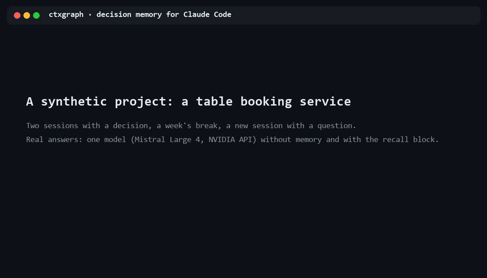

**First install [uv](https://docs.astral.sh/uv/getting-started/installation/):** Windows (PowerShell) `powershell -ExecutionPolicy ByPass -c "irm https://astral.sh/uv/install.ps1 | iex"`; macOS / Linux `curl -LsSf https://astral.sh/uv/install.sh | sh` (or `brew install uv`, `pip install uv`).

# ctxgraph: local decision memory for Claude


ctxgraph remembers what you decided in earlier conversations of a project: what to do, what not to do, what was
put off for later, which rules always hold, and how a decision changed over time. In a new session Claude asks the
memory before answering instead of guessing or asking you again. Everything is stored and searched on your own
computer; there is no account, no API key and no cloud service.



The example in the animation is synthetic.

## What the plugin adds

- **MCP server `ctxgraph`** (local, stdio) with the tools `overview`, `recall`, `expand`, `decisions`, `later`,
  `rules`, `pin_rule`, `unpin_rule`, `remember`, `save_chat`, `import_history`, `import_claude_ai`, `forget`,
  `memory_status` and `show_graph`.
- **Skill `project-memory`**: when Claude should call which tool, and how to keep the calls short (one overview per
  new chat, one recall before an answer that needs history, brief results, no repeats of what is already shown).
- **Hooks (Claude Code)**: `Stop` appends the path of the session transcript to a local queue after each reply, so
  new turns are recorded automatically; `SessionStart` prints one line with open "later" items, if there are any.

## Install

Install uv once (see the first line of this page; uv runs the Python package and fetches Python 3.11+ if
missing), then add the plugin in Claude Code:

```
/plugin marketplace add egor-ml-research/think-to-recall
/plugin install ctxgraph@think-to-recall
```

Then restart Claude Code. `uvx` must be on PATH. Once the plugin is listed in the Claude plugin directory, you can also
add it from there. In a new chat, ask
Claude "what did we decide about X?" or "import my earlier sessions of this project" (the `import_history` tool).

If you already connected ctxgraph by hand with `ctxgraph setup`, keep only one of the two: remove the old server
(`claude mcp remove ctxgraph`) and the `ctxgraph` hooks from `.claude/settings.local.json`, or skip the plugin.

## How the package is installed (network use)

The MCP server and the hooks run `uvx` with the package `think-to-recall` pinned to one exact version on PyPI:

```
uvx --from think-to-recall==0.6.7 ctxgraph-mcp
```

On the first run uv downloads that version and its Python dependencies from PyPI (pymorphy3, yake,
numpy, requests, mcp, networkx, nltk), and caches them. Later runs use the cache and need no network. This install
step is the only network use of the plugin.

## Privacy

- **Everything stays on your computer.** The memory is a SQLite file in `~/.ctxgraph/<project>/`. Recall, the
  decision list, the overview and the graph view are computed locally. ctxgraph sends nothing to Anthropic, to the
  author, or to any other server, and has no telemetry.
- **What it reads:** this project's Claude Code transcripts (`~/.claude/projects/...`), only for the project you
  work in; the chats you explicitly pass to `save_chat`; a claude.ai data export only when you ask to import it;
  `.beads/*.jsonl` issues read-only if the project has them; and the project's git log (local `git` command,
  read-only) for the overview.
- **Scrubbing:** secrets and personal data (keys, tokens, e-mail addresses, phone numbers and similar patterns) are
  replaced before anything is stored.
- **Default mode needs no downloads:** recall uses BM25 keyword search. Nothing else is fetched unless you opt in.
- **Optional downloads, only when you run them yourself in a terminal** (none of them is run by the plugin):
  - `ctxgraph setup --quality`: downloads the multilingual-e5-base encoder (about 300 MB, from Hugging Face) for
    better recall; needs the `[quality]` extra.
  - `ctxgraph setup --wordnet yes`: downloads the WordNet corpus (about 10 MB, from the NLTK data server) for topic
    names in English.
  - `ctxgraph setup --graphify yes`: installs the `graphifyy` package from PyPI and builds a local code graph of the
    project (no LLM, no key) for the overview.
- **Removal:** uninstall the plugin, then delete `~/.ctxgraph/<project>` (or all of `~/.ctxgraph`).

## Where it works

The MCP server is a local program, and hooks are a Claude Code feature, so the full plugin works in Claude Code
(terminal, IDE extensions, the Code tab of the Claude desktop app) and in Cowork tasks that run on your computer.
In claude.ai chat (web, desktop chat, mobile) only the skill loads; local MCP servers are not started there.

## Support

Questions and bug reports: [GitHub issues](https://github.com/egor-ml-research/think-to-recall/issues).
Source, full documentation and the Russian README: [github.com/egor-ml-research/think-to-recall](https://github.com/egor-ml-research/think-to-recall).

License: Apache-2.0.
